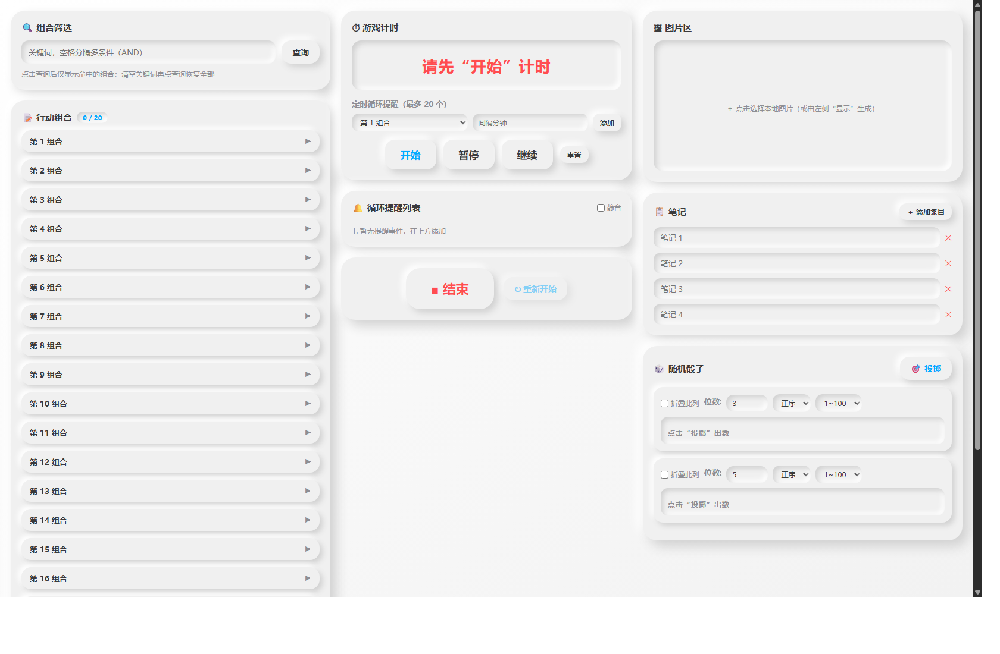
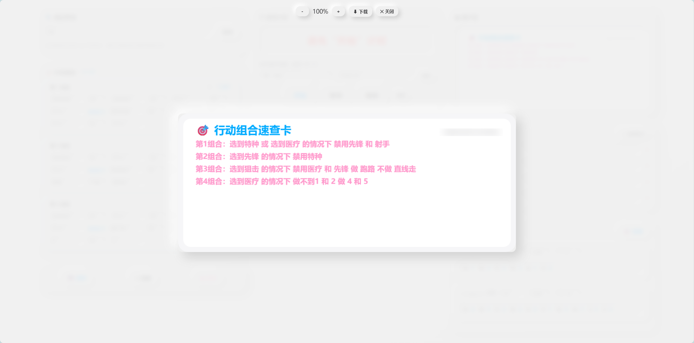
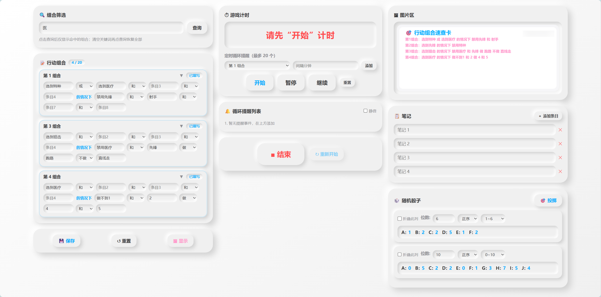
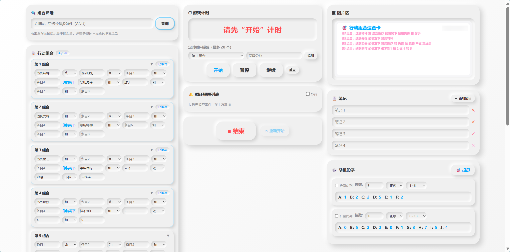
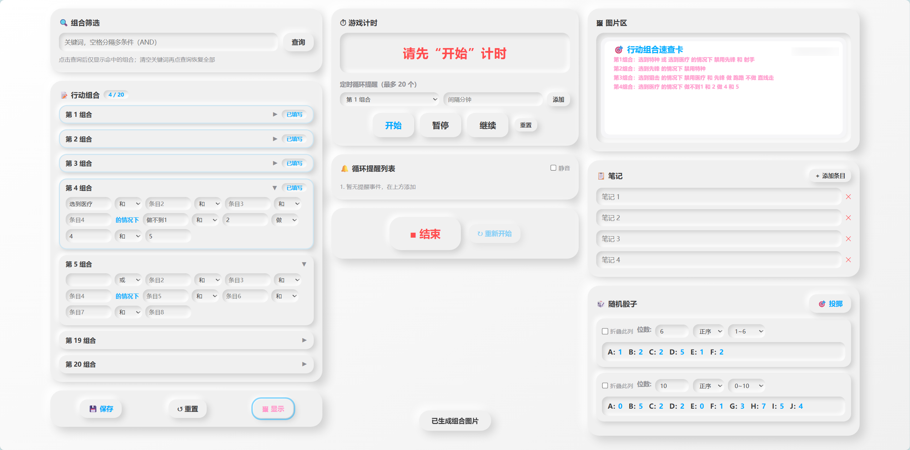
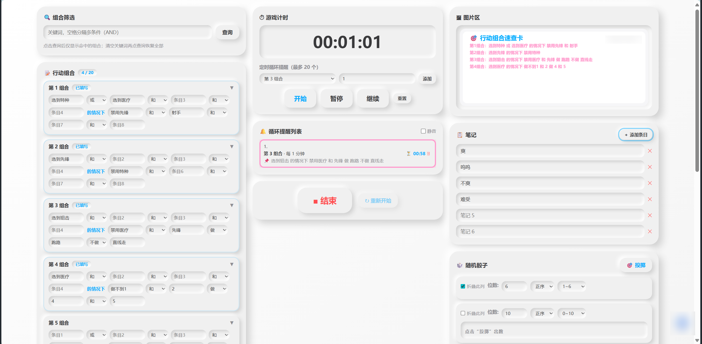

# Control Panel

新拟态（Neumorphism）风格的纯前端游戏辅助工作台：行动组合填写与筛选、游戏计时、定时循环提醒、图片速查区、随机骰子。由AI编写。

**零构建、零依赖、零服务端、零联网** —— 下载后双击 `index.html` 即可使用。








## 功能一览

| 区域 | 功能 |
|---|---|
| 左上 | 关键词筛选组合（空格分隔多条件 AND 关系） |
| 左中 | 20 个行动组合：8 个填空 × 6 个「和/或/做/不做」下拉，固定结构「…的情况下…」 |
| 左下 | 保存（浏览器覆盖存储）/ 重置 / 生成组合速查图（悬空连接词自动省略） |
| 中上 | 游戏计时（开始 / 暂停 / 继续 / 小重置）+ 最多 20 个定时循环提醒设置 |
| 中中 | 提醒列表：组合内容快照 + 剩余倒计时；到点行高亮闪烁 + 提示音（可静音） |
| 中下 | 结束（冻结全局）/ 重新开始（保留组合、清空笔记、提醒倒计时重置） |
| 右上 | 图片区：本地选图 / 生成图；点击已有图片进入灯箱（缩放·拖拽·下载） |
| 右中 | 自由笔记列表（默认 4 条，可增删） |
| 右下 | 真随机骰子（`crypto.getRandomValues` 拒绝采样）：位数 1~26、正/倒序、范围 0~10 / 1~100 / 1~6 |

### 计时规则（重要）

- **开始**：唯一的启动入口，红字"请先开始计时"消失、时间出现。
- **暂停 / 继续**：仅计时中 / 暂停中有效；未开始时点击会提醒。
- **重置（小）**：弹确认框——选"是"则**计时归零并停表**，回到待开始红字状态，**同时所有循环提醒倒计时一并重置**；选"否"则计时完全不受影响。**弹窗期间计时暂停**
- **结束**：冻结全部计时与提醒；**重新开始**后保留已保存的组合，仅清空笔记。

## 从 GitHub 下载后如何运行

**无需任何环境配置**（没有 Node、没有 API Key、没有后端、没有构建步骤）：

### 方式一：直接打开（最简单）
双击 `index.html`，用 Chrome / Edge / Firefox 打开即可。

### 方式二：本地静态服务器（可选）
```bash
# Python
python -m http.server 8000

# 或 Node
npx serve .
```
然后浏览器访问 `http://localhost:8000`。

### 离线使用
整个项目不引用任何外部资源（无 CDN、无外部字体、无网络请求），**拷到 U 盘或离线电脑上双击 `index.html` 即可完整运行**。

## 数据存在哪里

所有数据仅保存在**当前浏览器的 localStorage** 中，不上传任何服务器：

| Storage 键 | 内容 |
|---|---|
| `gm.combos.v1` | 已保存的 20 个组合 |
| `gm.notes.v1` | 笔记条目 |
| `gm.dice.v1` | 骰子列配置 |
| `gm.reminders.v1` | 循环提醒事件 |

> 换浏览器 / 清除网站数据后记录不会跟随——项目本身不含任何用户数据。

## 项目结构

```
website/
├── index.html        # 页面骨架（三栏九区）
├── css/style.css     # 新拟态设计系统
├── js/
│   ├── store.js      # localStorage + Toast + WebAudio 蜂鸣
│   ├── combos.js     # 组合填写 / 保存 / 筛选 / 文本压缩
│   ├── timer.js      # 游戏计时状态机
│   ├── reminders.js   # 循环提醒
│   ├── image.js      # 图片区 + 灯箱 + Canvas 生成图
│   ├── notes.js      # 笔记
│   ├── dice.js       # 真随机骰子
│   └── app.js        # 总装配
├── docs/
│   ├── PRD.md         # 需求文档
│   └── screenshot.png # 页面预览
└── README.md
```

## 提交到 GitHub

本仓库**不含任何敏感信息**（无密钥、无用户数据、无环境文件），直接推送：

```bash
cd website
git init
git add .
git commit -m "feat: Control v1.0"
git branch -M main
git remote add origin https://github.com/<你的用户名>/<仓库名>.git
git push -u origin main
```
